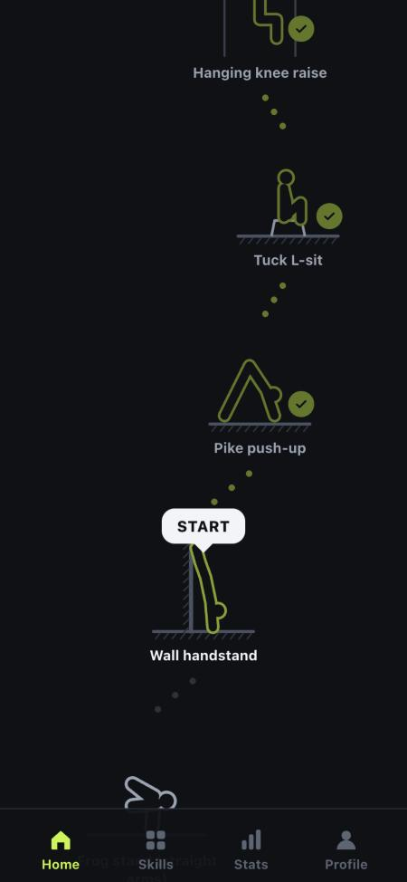
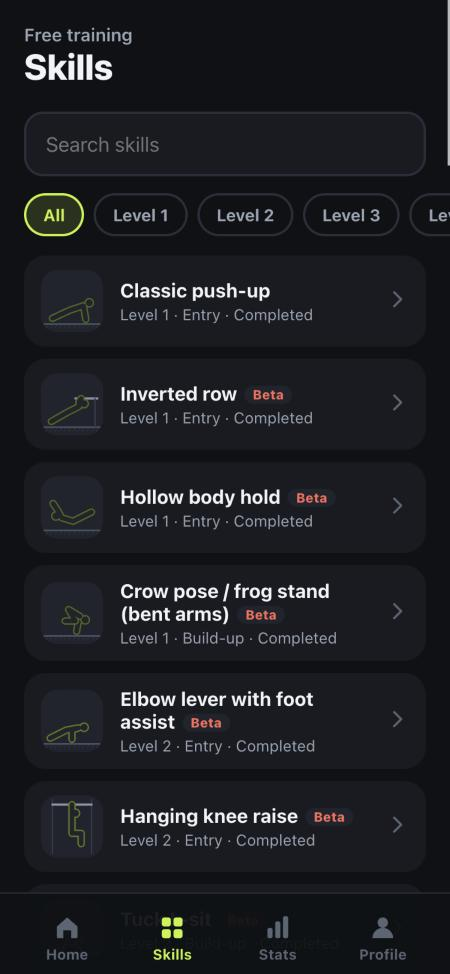
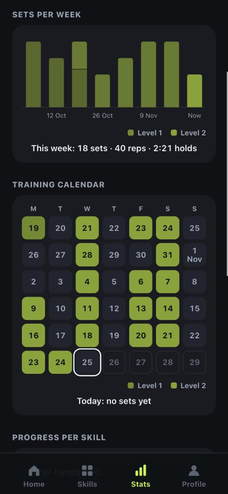
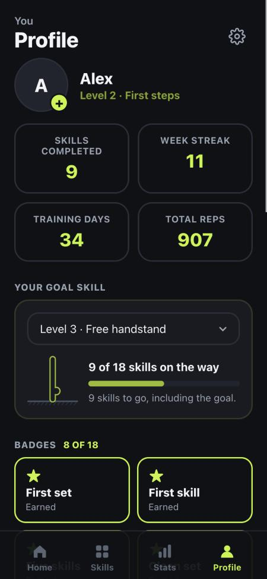
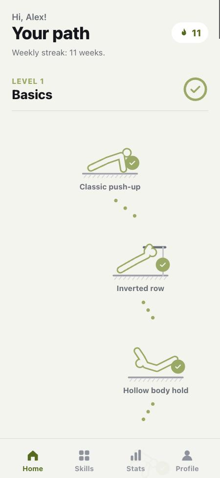

# Calisthenics AI Coach

An AI coach that watches your calisthenics form through the camera and gives you **live spoken feedback** while you train. It counts reps, times holds, scores your form and guides you along a skill path from your first push-up to elite skills.

It runs in the browser. There is nothing to install, and **no images or video leave your device**.

**Live demo:** [calisthenics-ai-coach.pages.dev](https://calisthenics-ai-coach.pages.dev) (best on a phone; allow camera access to train)

<p>
  
  &nbsp;
  
  &nbsp;
  
</p>
<p>
  
  &nbsp;
  
  &nbsp;
  
</p>

<sub>Screenshots show generated sample data for a user called Alex after 11 weeks of training.</sub>

## Features
- **Mobile app layout:** welcome screen with your name, a **Home** tab with your path, a **Skills** tab for free training and a **Profile** tab, switched with a bottom tab bar
- **Works offline** once loaded (a native App Store and Play Store version is planned)
- **Workouts with sets and rest:** set your own number of sets (1 to 10) and rest time (15 seconds to 10 minutes, default 3 sets with 1:30 rest); a spoken countdown runs between sets and the next set starts by itself, so you never have to walk to the phone. The screen stays on during the workout
- **Stats tab:** sets per week split by level, a training calendar that shows the date and the highest level trained each day, a progress curve per skill with its goal, and personal bests
- **Guided setup for every skill:** the coach talks you into the starting position step by step, from placing the camera to the first hold
- **Profile:** photo, current level, overview (skills completed, week streak, training days, total reps), a goal skill with the way there, badges, and optional body data
- **Optional account:** sign in with a 6-digit email code (no password) to keep your progress safe and use it on several devices. Progress from all devices is merged, so nothing gets lost. Account data is stored by Supabase in the EU (Frankfurt). The app works fully without an account
- **Dark and light mode:** "Graphite and lime" and "Light and lime", following the phone or fixed in the settings
- **Settings:**
  - Appearance: system, dark or light
  - Training: countdown before each set (off, 3, 5 or 10 s, default 5), guided setup (first time, always or never), strictness (easy, normal or strict)
  - Camera: front or back (also switchable while filming), body lines on the video, mirror the front camera
  - Coach: voice on/off (the phone sets the volume), counts and form tips or counts only, vibration
  - Help and data: show guides and the safety notice again, reset progress
- **Times as minutes:seconds** everywhere (for example 1:30)
- **Live voice and visual feedback** during the exercise (not after it), with a calm, encouraging tone
- **Pose detection in the browser** with MediaPipe: the camera image is analyzed on your device and never uploaded
- **Rep counting and hold timer**, including partial reps that do not reach the full range
- **Form score and summary** after each set, with the most common errors
- **Skill path** with 7 levels and 51 skills, from the classic push-up to the iron cross, shown as a road of outline figures in each pose, colored in steps of lime by level
- **Free choice of skills** in the Skills tab (search and level filter), with a safety hint when a skill belongs to a level you have not unlocked yet
- **Coach warning** for high-risk skills (hefesto, iron cross, one-arm muscle-up, maltese, victorian)
- **Progress and weekly streak**, saved on your device and optionally synced with an account
- **Pause and resume** (the camera turns fully off while paused)

## Status
| Part | State |
|------|-------|
| Push-up | Tested rules (side view): plank check, knee push-ups ignored, hip sag and high hips, depth |
| All other 50 skills | **Beta**: rules follow the [technique guide](docs/technique-guide.md) but are **not tested with real people yet** |
| Skill path, progress, streak, stats, badges | Working, stored on the device |
| Optional account and sync | Built (Supabase, EU); needs a Supabase project to run |
| Native App Store and Play Store app | Planned (Capacitor) |

## How to run
You need [Node.js](https://nodejs.org/) 20 or newer.

```bash
git clone https://github.com/larissangongomilly/calisthenics-ai-coach.git
cd calisthenics-ai-coach
npm install
npm run dev
```

Open the address that Vite shows (usually `http://localhost:5173`) and allow camera access. The camera only works on `localhost` or over HTTPS.

**Test on your phone (same Wi-Fi):** run `npm run dev:phone` and open the `Network` address it prints (for example `https://192.168.0.10:5173`) on your phone. The dev server uses a self-signed certificate, so the browser shows a security warning once; accept it to continue. HTTPS is needed because browsers only allow the camera on secure pages.

**Tests:** `npm test` runs the automated tests (Node's built-in test runner, no extra packages). They cover progress and streak rules, level unlocking, the camera rules with simulated poses, the guided setup, the figures, settings, stats, badges and the account sync (merging progress from several devices).

**Accounts (optional):** without the two variables below the app runs fully offline and hides the account section.

1. Create a Supabase project (region: Frankfurt) and run [`supabase/migrations/001_init.sql`](supabase/migrations/001_init.sql) in its SQL editor. It creates one table with row level security (every user can only read and change their own row) and a `delete_account()` function for in-app account deletion.
2. In Authentication → Emails, add `{{ .Token }}` to the "Magic Link" and "Confirm signup" templates, so the email contains the 6-digit code.
3. Copy `.env.example` to `.env.local` and fill in the project URL and anon key (Project Settings → API). For the hosted version, add the same two variables in the Cloudflare Pages settings.

**Production build:** `npm run build` creates the app in `dist/`. The live demo is hosted on Cloudflare Pages (build command `npm run build`, output folder `dist`) and deployed on every push to `main`.

**App icon:** `node scripts/make-icon.mjs` writes the icon SVGs to `public/icons/`. The PNG sizes were made from them on macOS (`qlmanage -t -s 512`, then `sips -z`).

**Tip:** Place the camera so your whole body is visible. Most skills need a side view; each skill card tells you how to film.

## Tech stack
- **Frontend:** Vite and plain JavaScript (ES modules), no framework; mobile-first CSS with dark and light themes built on CSS variables
- **Pose detection:** [MediaPipe Pose Landmarker](https://ai.google.dev/edge/mediapipe/solutions/vision/pose_landmarker), running fully on the device
- **Voice and device:** Web Speech API for the spoken coach, Screen Wake Lock, vibration
- **Charts and figures:** hand-written SVG (no chart library)
- **Account (optional):** [Supabase](https://supabase.com) in the EU: email code sign-in, Postgres with row level security, in-app account deletion
- **Tests:** Node's built-in test runner, 71 tests
- **Hosting:** Cloudflare Pages

## How it works
1. **MediaPipe Pose Landmarker** finds 33 body points in every video frame.
2. `src/pose.js` turns them into joint angles (elbow, hip, knee, body line, tilt).
3. `src/exercises.js` holds the rules for each skill: starting position, form checks, rep or hold logic.
4. `src/tracker.js` runs those rules during a set and builds the summary.
5. Feedback is spoken with the browser's speech synthesis.

Docs:
- [Product decisions](docs/decisions.md)
- [Push-up form](docs/pushup-form.md)
- [Skill path, progress and streak rules](docs/skill-path.md)
- [Technique guide for all skills](docs/technique-guide.md)

## Limitations
- **Beta rules:** Only the push-up has been tested. The feedback for all other skills may be wrong.
- **One camera, 2D only:** The app cannot see depth, muscle tension, hand pressure or whether your lower back touches the floor. It also cannot tell whether you face up or down (for example front lever vs. back lever).
- **Visibility:** Feedback stops when joints are hidden. Loose clothing, low light or a cut-off body make detection worse.
- **Wake lock:** Keeping the screen on needs a recent browser (iOS 16.4+, current Chrome). On older ones, set the auto-lock time of the phone higher while training.
- **Local progress:** Without an account, progress lives in your browser. It is lost if you clear your browser data or switch device. With an account, it is synced.
- **Reset with several devices:** "Reset all progress" also clears the account, but another signed-in device still has its own copy and adds it back on its next sync.
- **Levels and criteria are preliminary** and not reviewed by calisthenics experts.
- English only for now.
- **Web app for now:** it is designed to become an App Store and Play Store app later, but today it runs in the browser.

## Safety
This app gives **general guidance only. It does not replace a coach, trainer or doctor.**
Warm up first, use a stable surface or bar, and stop right away if you feel pain, dizziness or lose control. Advanced skills on rings, one-arm skills and the hefesto need proper equipment, step-by-step assistance and a qualified coach.

## About
Built with AI assistance (Claude). Product idea, design decisions and testing by Larissa.

## License
Copyright © 2026 Larissa. **All rights reserved.**

You may **look at the code**, for example as part of my portfolio. That is the only permission given. Without my written permission you may **not**:

- copy or reuse the code, in whole or in part
- change it or build on it (no modified versions)
- share, publish or sell it, or use it in your own apps or products

This is not an open source project, and no open source license applies. If you want to use something from it, please ask me first.

Third-party libraries (such as MediaPipe) keep their own licenses.
