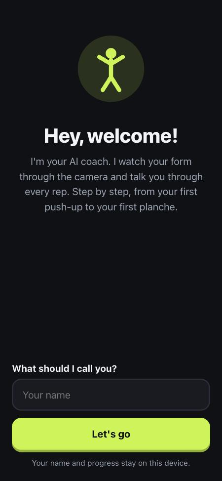

# Calisthenics AI Coach

An AI coach that watches your calisthenics form through the camera and gives you **live spoken feedback** while you train. It counts reps, times holds, scores your form and guides you along a skill path from your first push-up to elite skills.

It runs in the browser. There is nothing to install, and **no images or video leave your device**.

<p>
  
  &nbsp;
  
  &nbsp;
  
</p>

## Features
- **Mobile app layout:** welcome screen with your name, a **Home** tab with your path and a **Skills** tab for free training, switched with a bottom tab bar
- **Live voice and visual feedback** during the exercise (not after it), with a calm, encouraging tone
- **Pose detection in the browser** with MediaPipe: the camera image is analyzed on your device and never uploaded
- **Rep counting and hold timer**, including partial reps that do not reach the full range
- **Form score and summary** after each set, with the most common errors
- **Skill path** with 7 levels and 51 skills, from the classic push-up to the iron cross, shown as a road of outline figures in each pose (each skill gets its own color once you reach it)
- **Free choice of skills** in the Skills tab (search and level filter), with a safety hint when a skill belongs to a level you have not unlocked yet
- **Coach warning** for high-risk skills (hefesto, iron cross, one-arm muscle-up, maltese, victorian)
- **Progress and weekly streak**, saved in your browser
- **Pause and resume** (the camera turns fully off while paused)

## Status
| Part | State |
|------|-------|
| Push-up | Tested rules (side view): plank check, knee push-ups ignored, hip sag and high hips, depth |
| All other 50 skills | **Beta**: rules follow the [technique guide](docs/technique-guide.md) but are **not tested with real people yet** |
| Skill path, progress, streak | Working, stored locally |

## How to run
You need [Node.js](https://nodejs.org/) 20 or newer.

```bash
git clone https://github.com/larissangongomilly/calisthenics-ai-coach.git
cd calisthenics-ai-coach
npm install
npm run dev
```

Open the address that Vite shows (usually `http://localhost:5173`) and allow camera access. The camera only works on `localhost` or over HTTPS.

**Test on your phone (same Wi-Fi):** run `npm run dev:phone` and open the `Network` address it prints (for example `https://192.168.0.10:5173`) on your phone. The dev server uses a self-signed certificate, so the browser shows a security warning once; accept it to continue. HTTPS is needed because browsers only allow the camera on secure pages.

**Tests:** `npm test` runs the automated tests (Node's built-in test runner, no extra packages). They cover progress and streak rules, level unlocking, the camera rules with simulated poses, the guided setup and the figures.

**Production build:** `npm run build` creates the app in `dist/`. The test version is hosted on Cloudflare Pages (build command `npm run build`, output folder `dist`) behind Cloudflare Access, so only invited people can open it.

**Tip:** Place the camera so your whole body is visible. Most skills need a side view; each skill card tells you how to film.

## How it works
1. **MediaPipe Pose Landmarker** finds 33 body points in every video frame.
2. `src/pose.js` turns them into joint angles (elbow, hip, knee, body line, tilt).
3. `src/exercises.js` holds the rules for each skill: starting position, form checks, rep or hold logic.
4. `src/tracker.js` runs those rules during a set and builds the summary.
5. Feedback is spoken with the browser's speech synthesis.

Docs:
- [Product decisions](docs/decisions.md)
- [Push-up form](docs/pushup-form.md)
- [Skill path, progress and streak rules](docs/skill-path.md)
- [Technique guide for all skills](docs/technique-guide.md)

## Limitations
- **Beta rules:** Only the push-up has been tested. The feedback for all other skills may be wrong.
- **One camera, 2D only:** The app cannot see depth, muscle tension, hand pressure or whether your lower back touches the floor. It also cannot tell whether you face up or down (for example front lever vs. back lever).
- **Visibility:** Feedback stops when joints are hidden. Loose clothing, low light or a cut-off body make detection worse.
- **Local progress:** Progress lives in your browser. It is lost if you clear your browser data or switch device.
- **Levels and criteria are preliminary** and not reviewed by calisthenics experts.
- English only for now.
- **Web app for now:** it is designed to become an App Store and Play Store app later, but today it runs in the browser.

## Safety
This app gives **general guidance only. It does not replace a coach, trainer or doctor.**
Warm up first, use a stable surface or bar, and stop right away if you feel pain, dizziness or lose control. Advanced skills on rings, one-arm skills and the hefesto need proper equipment, step-by-step assistance and a qualified coach.

## About
Built with AI assistance (Claude). Product idea, design decisions and testing by Larissa.
